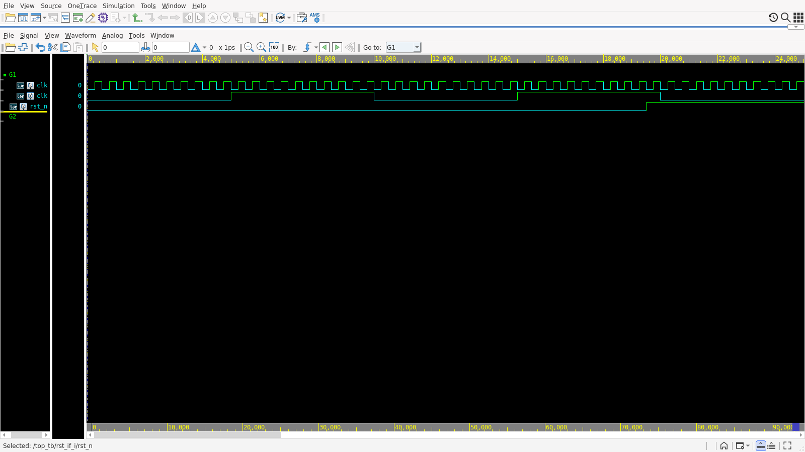
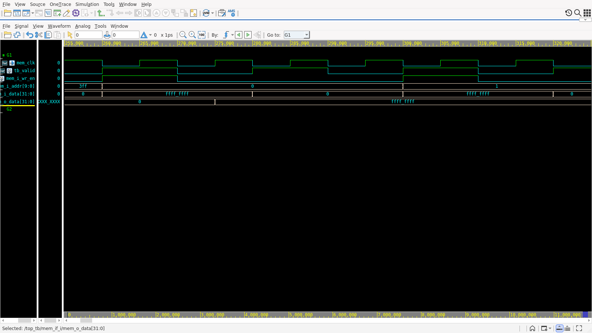
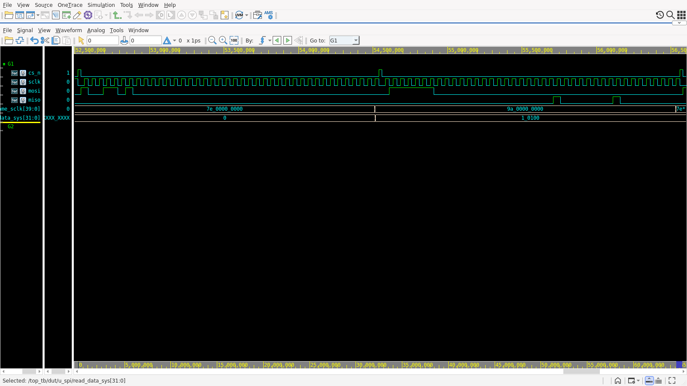
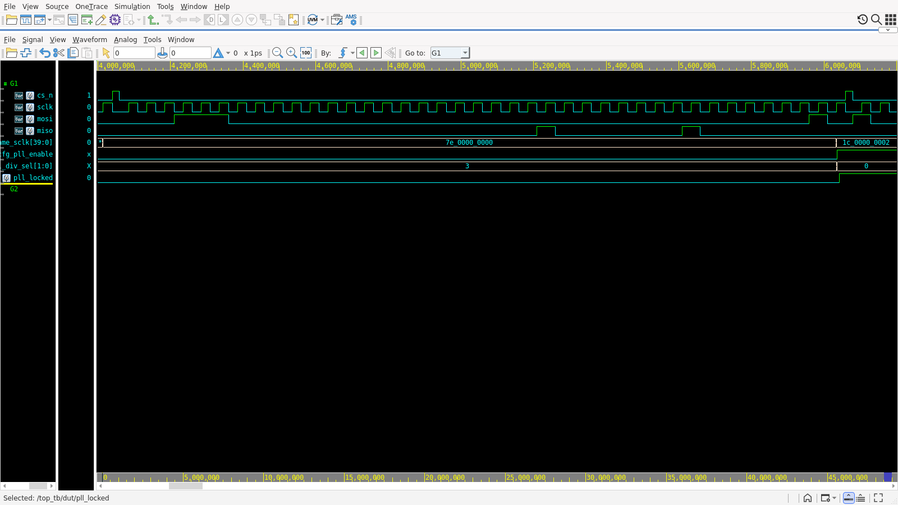
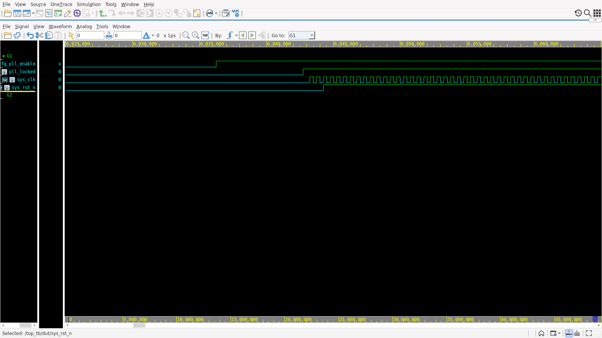
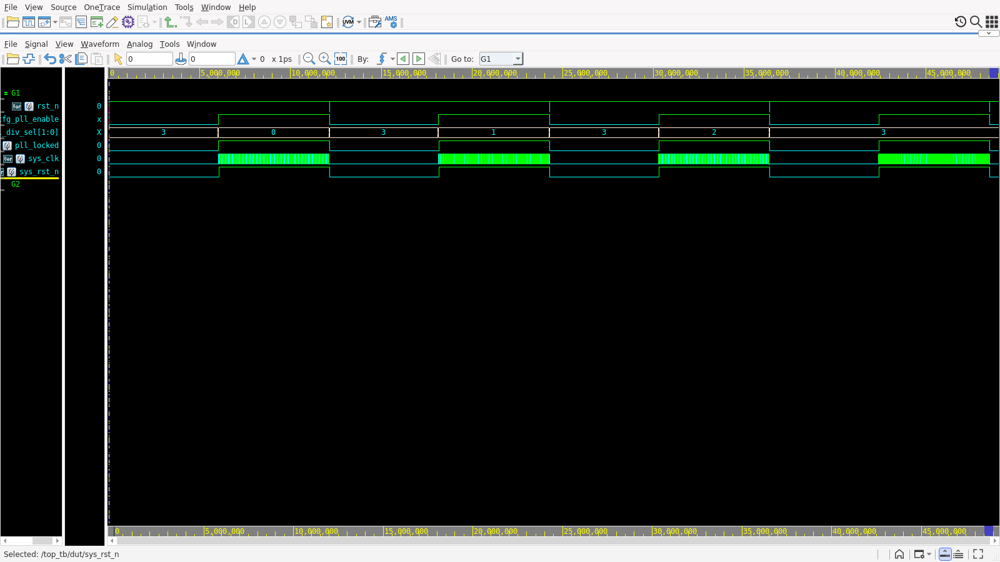
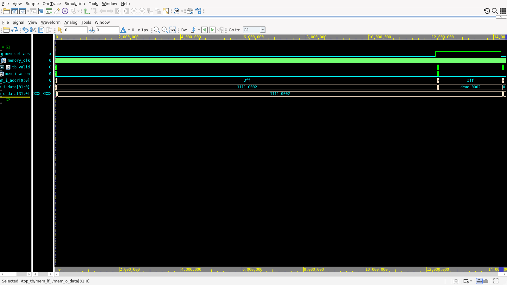
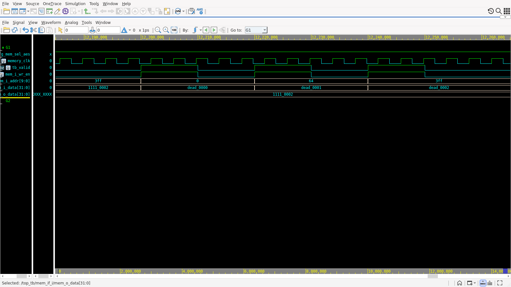
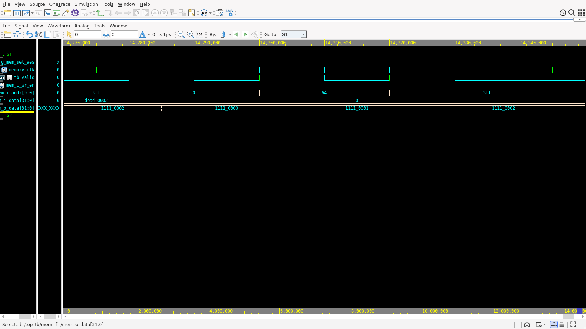
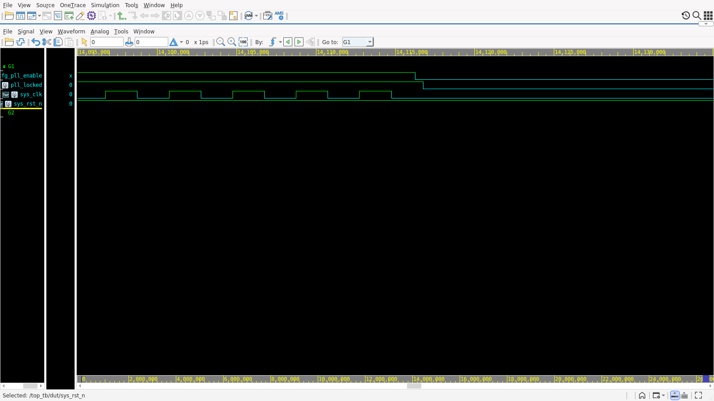

# Evidências de novembro — como ler e como refazer

Checkpoint de 30/11/2026: VIPs de CLK, RESET, SPI e MEMORY DATA, configuração
básica do DUT, monitores e checagens locais. Tudo nesta pasta foi gerado em
25/11/2026 com VCS X-2025.06-SP2 e UVM-1.2, seed 1 nos prints.

## O que tem aqui

| Pasta / arquivo | Conteúdo |
|---|---|
| `regress.txt` | Saída do `make regress`: 6 testes × seeds 1, 2, 3 → **18/18 PASS** |
| `logs/` | Log de compilação e os 18 logs da regressão (todos com `TEST PASSED`) |
| `falhas_provocadas/` | 3 falhas feitas de propósito + o bug real OPEN-01 (todos com `TEST FAILED`) |
| `prints/` | 10 prints do Verdi (nWave), explicados abaixo |
| `waves/` | Um FSDB por teste (seed 1), para abrir no Verdi e explorar |

## Os prints

### 01 — Clock e reset (`minisoc_smoke_test`, 0–25 ns)

`clk` de 2 GHz (500 ps), `mem_clk` de 100 MHz (10 ns) e `rst_n` em 0 desde o
tempo zero, solto em 20 ns (39 ciclos sorteados pela seed 1) numa borda de descida.

### 02 — Escrita e leitura na memória (`minisoc_mem_rw_test`, 255–325 ns)

Cada acesso dura 1 ciclo com `tb_valid = 1`, seguido de 1 ciclo livre.
Escrita: `wr_en = 1`, `addr = 0`, `data = ffff_ffff`. Leitura do mesmo endereço:
`wr_en = 0` e `mem_o_data` passa a `ffff_ffff` na subida seguinte.

### 03 — Leitura SPI do VERSION (`minisoc_rst_default_test`, 52,5–56,6 µs)

Dois frames de 40 bits (`cs_n` baixo). `rx_frame_sclk` mostra o último frame
que o DUT recebeu: `7e_0000_0000` é o NOP da leitura anterior; ao fim do 1º frame
vira `9a_0000_0000` = `RWb = 1` + endereço `0x0D` (pedido de leitura). O DUT guarda
o valor em `read_data_sys = 0x0001_0100`. No 2º frame (NOP), esse valor sai bit a
bit no **MISO** (os dois pulsos são os bits 1 de `0x00010100`).

### 04 — Escrita SPI em SYSTEM_CONTROL (`minisoc_pll_bringup_test`, 4,0–6,2 µs)

Um frame só. Ao fim dele, `spi_cfg_pll_enable` vai a 1 com `PLL_DIV_SEL = 0` (/1).

### 05 — PLL travando (`minisoc_pll_bringup_test`, 6,025–6,065 µs)

`PLL_ENABLE = 1` → alguns ciclos depois `pll_locked = 1` → o `sys_clk` começa →
`sys_rst_n` só sobe **3 ciclos de `sys_clk` depois** (reset interno do domínio AES).

### 06 — Os 4 divisores (`minisoc_pll_bringup_test`, 0–49 µs)

Quatro configurações seguidas: `div_sel` 0, 1, 2, 3 → `sys_clk` de 500, 1000,
2000 e 4000 ps (medido pelo teste). Entre elas, um reset (`rst_n` cai) volta tudo
ao padrão (`div_sel = 3`, PLL desligado).

### 07 — Ownership, visão geral (`minisoc_mem_owner_test`, 0–14,4 µs)

Três escritas com `MEM_SEL_AES = 0`; o SPI configura o DUT e põe `MEM_SEL_AES = 1`;
três escritas "intrusas"; o SPI devolve a memória (`MEM_SEL_AES = 0`); três leituras.

### 08 — Escrita bloqueada (12,185–12,265 µs)

Com `MEM_SEL_AES = 1` o testbench manda `dead_0000…dead_0002` nos endereços
0, 0x64 e 0x3ff. O `memory_clk` agora é o `sys_clk` (dono = AES) e as escritas
externas **não entram**.

### 09 — Valor antigo continua lá (14,27–14,35 µs)

De volta com `MEM_SEL_AES = 0`, a leitura devolve `1111_0000`, `1111_0001`,
`1111_0002` — os valores de antes. O `mem_scoreboard` compara e dá 0 erros.

### 10 — Bug OPEN-01 (`minisoc_pll_reenable_test`, 14,095–14,135 µs)

O SPI desliga o PLL: `spi_cfg_pll_enable` cai, `pll_locked` cai e o `sys_clk`
para. Mas `sys_rst_n` **continua em 1**: o `sys_reset_pipe` só é limpo numa borda
de `sys_clk`, que não vem mais. A assertion A-02a dispara a partir de 14,117 µs.
Log completo em `falhas_provocadas/bug_open01_pll_reenable.log`.

## Falhas provocadas (prova de que os checkers funcionam)

Cada uma foi feita alterando **um** arquivo de propósito, rodando o teste e
restaurando o original logo depois (a regressão de `regress.txt` é com o código original).

| Log | O que foi estragado | O que o testbench disse |
|---|---|---|
| `mem_scoreboard_modelo_errado.log` | `mem_scoreboard` guarda `data ^ 1` no modelo | `[MEM_SCB] addr=0: lido 0x00000000, esperado 0x00000001` → TEST FAILED |
| `spi_scoreboard_reset_errado.log` | espelho do SPI com `NUM_BLOCKS = 2` no reset | `[SPI_SCB] addr=0x0a: lido 0x00000001, esperado 0x00000002` → TEST FAILED |
| `sva_a09_sclk_rapido.log` | `spi_driver` com `sclk` a 33 MHz (meio período 15 ns) | `[SVA_A09] periodo de sclk menor que 40 ns` → TEST FAILED |
| `bug_open01_pll_reenable.log` | nada — **bug real do RTL** | `[SVA_A02a] sys_rst_n = 1 com PLL_LOCKED = 0` → TEST FAILED |

## Como refazer tudo

Rodar de `verif/`, num terminal com o ambiente da Synopsys carregado (licença e `VCS_HOME`).

**Regressão e logs**
```bash
make regress                                   # 18 runs, tabela no fim
make run TEST=minisoc_mem_rw_test SEED=1       # um teste só
```

**Prints automáticos** — o script abre o Verdi numa tela virtual (Xvfb), adiciona
os sinais, dá zoom e salva o PNG (leva ~30 s por print):
```bash
make run TEST=minisoc_mem_rw_test SEED=1 WAVES=fsdb       # gera sim/waves.fsdb
scripts/verdi_print.sh sim/waves.fsdb meu_print.png 255 325 \
    /top_tb/mem_if_i/mem_clk /top_tb/mem_if_i/tb_valid \
    /top_tb/mem_if_i/mem_i_wr_en /top_tb/mem_if_i/mem_i_addr \
    /top_tb/mem_if_i/mem_i_data /top_tb/mem_if_i/mem_o_data
```
Argumentos: FSDB, PNG de saída, início e fim do zoom **em ns**, e a lista de sinais.

**Prints à mão no Verdi**
1. `make run TEST=<teste> SEED=1 WAVES=fsdb` e depois `make verdi`
   (ou `verdi -dbdir sim/simv.daidir -ssf doc/evidencias/novembro/waves/<teste>.fsdb`).
2. Abrir o nWave: menu **Tools → New Waveform** (ou ícone do nWave).
3. Adicionar sinais: **Signal → Get Signals…**, navegar em `top_tb` e escolher
   (tabela abaixo). Selecionar os barramentos → botão direito → **Radix → Hexadecimal**.
4. Zoom: digitar o tempo inicial e final na barra (em ps) ou arrastar com o botão do meio.
5. Salvar: pelo menu **File → Print…** do nWave (opção de gravar em arquivo) ou
   com um print de tela da janela.

**Sinais usados em cada print**

| Interface | Caminho no Verdi |
|---|---|
| Clocks e reset | `/top_tb/ref_clk_if/clk`, `/top_tb/mem_clk_if/clk`, `/top_tb/rst_if_i/rst_n` |
| MEMORY DATA | `/top_tb/mem_if_i/{mem_clk, tb_valid, mem_i_wr_en, mem_i_addr, mem_i_data, mem_o_data}` |
| SPI (fios) | `/top_tb/spi_if_i/{cs_n, sclk, mosi, miso}` |
| SPI (dentro do DUT) | `/top_tb/dut/u_spi/rx_frame_sclk`, `/top_tb/dut/u_spi/read_data_sys` |
| Configuração | `/top_tb/dut/{spi_cfg_pll_enable, spi_cfg_pll_div_sel, spi_cfg_mem_sel_aes}` |
| PLL / domínio AES | `/top_tb/dut/{pll_locked, sys_clk, sys_rst_n, memory_clk}` |

**Falhas provocadas:** repetir a tabela acima à mão (editar o arquivo, `make compile`,
`make run …`, desfazer a edição). Nunca deixar a alteração no código.
